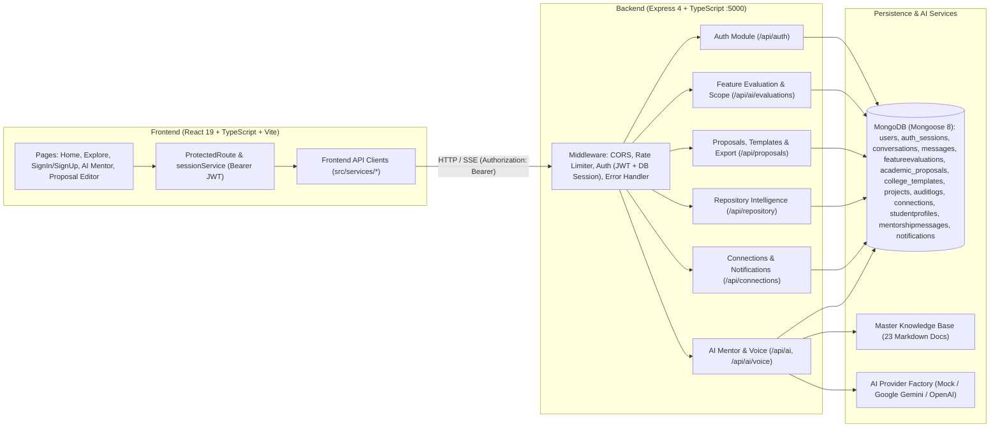
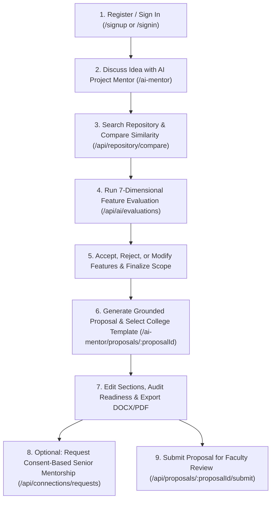
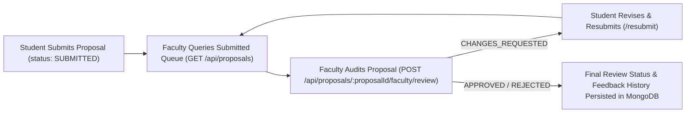

# CampusProjectHub

> **Build Projects. Preserve Knowledge. Connect Generations.**

**CampusProjectHub** is an AI-powered academic project management, repository intelligence, and mentorship platform designed to connect **students, seniors, faculty, and administrators** across engineering institutions.

---

## Table of Contents

- [1. Project Introduction](#1-project-introduction)
- [2. Problem Statement](#2-problem-statement)
- [3. Proposed Solution](#3-proposed-solution)
- [4. Key Features & Implementation Status](#4-key-features--implementation-status)
- [5. System Architecture](#5-system-architecture)
- [6. Technology Stack](#6-technology-stack)
- [7. Project Structure](#7-project-structure)
- [8. Installation and Setup (Windows)](#8-installation-and-setup-windows)
- [9. Screenshots and Demonstration](#9-screenshots-and-demonstration)
- [10. Database and Security](#10-database-and-security)
- [11. Project Workflows](#11-project-workflows)
- [12. Future Enhancements](#12-future-enhancements)
- [13. Academic Project Information](#13-academic-project-information)
- [14. Contribution and License](#14-contribution-and-license)

---

## 1. Project Introduction

Every academic year, thousands of engineering students build mini-projects and final-year capstones that are evaluated once and forgotten once semesters conclude. **CampusProjectHub** bridges this institutional memory gap by providing a centralized workspace where students can:

- Explore verified historical college projects before selecting a topic.
- Evaluate project feasibility and refine scope with a grounded **AI Project Mentor**.
- Generate structured, institution-formatted academic proposals and export them as `.docx` or `.pdf`.
- Request consent-based mentorship from senior students who worked on related campus projects.
- Submit academic proposals and project records for faculty review.

---

## 2. Problem Statement

Engineering colleges commonly face four recurring academic project challenges:

1. **Disconnected Academic Project Information**: Past abstracts, codebases, and reports remain scattered across personal drives, physical binders, or departmental folders with no searchable index.
2. **Repeated Project Ideas**: Without visibility into prior batches, student teams repeatedly propose identical capstone topics without building upon earlier limitations or lessons learned.
3. **Fragmented Project Management**: Topic ideation, feasibility validation, scope finalization, documentation formatting, and faculty reviews happen across disconnected tools.
4. **Loss of Knowledge Between Batches**: Graduating seniors take valuable architectural context, hardware pitfalls, and debugging experience with them, leaving junior batches to start from scratch.

---

## 3. Proposed Solution

CampusProjectHub addresses these issues through modular backend services integrated with a React web interface:

| Pillar | Current Implementation Scope |
| :--- | :--- |
| **Academic Project Management** | Implemented on the AI Mentor → Scope Finalization → Proposal Editor lifecycle (`AIMentorPage`, `ProposalEditorPage`), backed by MongoDB submission APIs (`/api/repository/submissions/*`, `/api/proposals/*`). Dedicated standalone student/faculty dashboard UIs are planned. |
| **Project Discovery & Knowledge Sharing** | Implemented in the Explore Projects catalog (`/explore-projects`), project detail views (`/explore-projects/:projectId`), and semantic/natural-language repository search (`/api/repository/search`, `/api/repository/compare`). |
| **Historical Project Repository** | Implemented in MongoDB (`projects` and `audit_logs` collections) with canonical seeding, duplicate detection, JSON/CSV bulk admin ingestion APIs, and historical verification endpoints. |
| **Senior–Junior Connection** | Implemented end-to-end with opt-in mentor profiles, privacy-masked public views, explicit consent confirmation, `PENDING` → `ACCEPTED` messaging locks, and persisted notifications (`/api/connections/*`, `MyConnectionsModal`, `RequestGuidanceModal`). |
| **Faculty Review & Guidance** | Implemented in backend APIs with role-based access control (`/api/proposals/:proposalId/faculty/review`, `/api/repository/submissions/:id/review`) and tracked feedback history rendered inside the Proposal Editor. Dedicated Faculty Dashboard UI is planned. |
| **AI-Powered Project Assistance** | Implemented via the conversational AI Project Mentor (`/api/ai/*`), grounded 23-document Master Knowledge Base (`docs/ai-mentor/knowledge/`), 7-dimensional Feature Evaluation Engine (`/api/ai/evaluations/*`), and Academic Proposal Generator (`/api/proposals/*`). |

---

## 4. Key Features & Implementation Status

Each module below reflects the actual state verified in the repository:

| Module / Feature | Status | Verified Implementation Details |
| :--- | :--- | :--- |
| **User Authentication & Role Management** | **Implemented** | `POST /api/auth/register`, `/login`, `/logout`, `GET /me`, admin provisioning (`/api/auth/admin/users`, `/bootstrap-admin`). Passwords hashed with Node `crypto.scryptSync` + per-user random salt; JWT verified against persisted `auth_sessions` in MongoDB. Frontend `/signin`, `/signup`, `ProtectedRoute`, `AuthButtons`. |
| **Student Dashboard** | **Partial / Unified Workspace** | Authenticated students are routed to `/ai-mentor` (central workspace for saved conversations, evaluations, scope versions, proposal creation, and mentorship modal). A separate `/dashboard/student` route does not yet exist. |
| **Faculty Dashboard** | **Backend Implemented / UI Planned** | Backend enforces faculty-only review APIs on submitted proposals and project submissions while denying access to unrelated private student conversations, evaluations, and unsubmitted `DRAFT` proposals. No dedicated `/dashboard/faculty` page exists yet in `src/pages/`. |
| **Project Creation & Management** | **Backend Implemented / Form UI Planned** | Student draft/edit/submit endpoints (`POST /api/repository/submissions/draft`, `PUT`/`PATCH /api/repository/submissions/:id`, `POST /submit`) exist and persist to MongoDB. UI workflows currently start through the AI Mentor and Proposal Editor rather than a standalone submission form. |
| **Project Discovery** | **Implemented** | `/explore-projects` and `/explore-projects/:projectId` filter by keyword, department, academic year, category, source type, and verification status using `/api/repository/search` and `/api/repository/compare` (falls back gracefully to `src/data/mockProjects.ts` when signed out or offline). |
| **Team Collaboration** | **UI Preview / Planned** | `TeamCollaborationSection.tsx` and `TeamWorkspacePreview.tsx` present team formation, task allocation, and milestone monitoring on the homepage; interactive team boards and member invites are not implemented yet. |
| **Project Repository** | **Implemented** | `MongoProjectModel` + `MongoAuditLogModel` store verified historical archives and student submissions; includes natural-language query parsing, similarity scoring, CSV/JSON admin import APIs, and strict email/phone redaction on public search results. |
| **AI Project Mentor** | **Implemented** | Multi-turn conversations (`/api/ai/conversations`), SSE streaming, conversation context tracking, 23 grounded knowledge docs, multilingual voice session support (`en`, `kn`, `hi` via `voice.service.ts` + browser speech APIs), and pluggable providers (`mock`, `gemini`, `openai`). |
| **Feature Evaluation & Scope Finalization** | **Implemented** | 7-dimensional rubric (`problemRelevance`, `userValue`, `originality`, `technicalFeasibility`, `complexity`, `resourceRequirements`, `timeSuitability`), 4 classification buckets (`ESSENTIAL`, `RECOMMENDED`, `OPTIONAL`, `UNNECESSARY`), decision persistence across reassessment, immutable scope versions, comparison, and confirmation. |
| **Academic Proposal Generation** | **Implemented** | Generates up to 15 canonical sections grounded in finalized or unfinalized scope; supports section editing, AI improvement previews without overwriting edits, autosave, version diff/restore, 9-criterion readiness audit, and binary `.docx` / `.pdf` exports (`ProposalEditorPage.tsx`). |
| **College Template Management** | **Implemented (Backend + Switcher UI)** | Persisted in MongoDB `college_templates` collection (`template.model.ts`), seeded with 4 engineering formats (VTU Mini-Project, VTU Synopsis, Autonomous IEEE 830 Report, IEEE Abstract). Students switch templates in `ProposalEditorPage.tsx` without losing manual edits; Admin CRUD routes exist on backend (`POST`/`DELETE /api/proposals/templates`). |
| **Senior–Junior Connection** | **Implemented** | `MongoProfileModel`, `MongoConnectionModel`, `MongoMessageModel`, `MongoNotificationModel`. Protects author contact details until consent, prevents self-requests and requests to opted-out mentors, locks chat until `ACCEPTED`, and logs notifications. |

---

## 5. System Architecture

CampusProjectHub uses a client–server REST architecture with React Router on the frontend, Express + TypeScript modular services on the backend, and MongoDB via Mongoose for persistence. In development, Vite proxies `/api/*` requests from port `5173` to the Express API on `127.0.0.1:5000`.



---

## 6. Technology Stack

Only libraries verified directly in [package.json](file:///d:/miniproject2.0/package.json), [backend/package.json](file:///d:/miniproject2.0/backend/package.json), and backend/frontend source files are listed below:

- **Frontend**: React 19, TypeScript, Vite 8 (`@vitejs/plugin-react`), React Router DOM 7, Tailwind CSS 4 (`@tailwindcss/vite`), Framer Motion, Lucide React
- **Backend**: Node.js, Express 4, TypeScript, Zod (request & env schema validation), CORS, `express-rate-limit`, `docx` (DOCX export), `pdfkit` (PDF export)
- **Database**: MongoDB, Mongoose 8
- **AI Integration**: Pluggable provider layer (`backend/src/modules/ai/ai.provider.ts`) supporting deterministic `MockAcademicMentorProvider`, Google Gemini (`GEMINI_API_KEY` / REST), or OpenAI (`OPENAI_API_KEY` / REST), Server-Sent Events (SSE) token streaming, Jaccard/keyword repository similarity engine, and browser Web Speech / MediaRecorder helpers
- **Authentication**: Server-side sessions (`auth_sessions`) + JSON Web Tokens (`jsonwebtoken`) + Node `crypto.scryptSync` / `crypto.timingSafeEqual` password hashing
- **Development Tools**: `tsx` (dev watcher and `node --test` TypeScript test runner), `oxlint` (linting), `dotenv`

---

## 7. Project Structure

```text
miniproject2.0/
├── docs/
│   └── ai-mentor/knowledge/       # 23 grounded academic reference & architecture Markdown docs
├── public/                        # Static Vite public assets
├── src/                           # Frontend React + TypeScript application
│   ├── components/
│   │   ├── ai-mentor/             # Chat UI, sidebar, voice modal, evaluation cards, scope & similarity modals
│   │   ├── auth/                  # AuthLayout, AuthInput, ProtectedRoute
│   │   └── connections/           # RequestGuidanceModal, MyConnectionsModal
│   ├── data/
│   │   └── mockProjects.ts        # Offline/unauthenticated demonstration dataset for Explore Projects
│   ├── pages/                     # Route pages: SignIn, SignUp, ExploreProjects, ProjectDetails, AIMentor, ProposalEditor
│   ├── sections/                  # Homepage sections (Hero, WhyChoose, HowItWorks, AILearning, TeamCollaboration, FinalCTA)
│   ├── services/                  # Typed API clients (auth, session, aiMentor, aiEvaluation, aiProposal, repository, connection, voice)
│   ├── styles/                    # Global Tailwind v4 styles
│   ├── types/                     # Shared TypeScript frontend interfaces
│   └── App.tsx                    # React Router route configuration
├── backend/
│   ├── src/
│   │   ├── config/                # env.ts (Zod env validation) & db.ts (Mongoose connection + DatabaseUnavailableError)
│   │   ├── middleware/            # auth.middleware.ts (JWT+session + requireRole), rateLimit.ts, error.middleware.ts
│   │   ├── modules/
│   │   │   ├── ai/                # Conversations, messages, SSE chat, conversational-engine/, feature-evaluation/, knowledge/, voice/
│   │   │   ├── auth/              # user.model.ts, session.model.ts, auth.service.ts, auth.controller.ts, auth.routes.ts
│   │   │   ├── connections/       # Senior-junior mentorship profiles, requests, messaging, notifications
│   │   │   ├── proposals/         # Proposal generator, readiness audit, college templates, DOCX/PDF binary export
│   │   │   └── repository/        # Historical & student projects, similarity search, CSV/JSON ingestion, audit logs
│   │   ├── tests/                 # 15 backend integration/unit test files + testAuth helper (172 tests)
│   │   ├── app.ts                 # Express app factory, CORS, /health, route mounting
│   │   └── server.ts              # DB connect, repository/profile/template seeding, HTTP server bootstrap
│   ├── .env.example               # Documented backend environment variables template
│   └── package.json               # Backend scripts & dependencies
├── .oxlintrc.json                 # Oxlint configuration
├── package.json                   # Frontend scripts & dependencies
├── vite.config.ts                 # Vite dev proxy (/api -> http://127.0.0.1:5000)
└── README.md
```

---

## 8. Installation and Setup (Windows)

### Prerequisites

- **Node.js** (v20+ LTS or v22/v24; tested with Node.js v24) and **npm**
- **MongoDB Community Server** running locally on `127.0.0.1:27017` (or a reachable MongoDB URI)

### 1. Clone the Repository

```powershell
git clone <repository-url>
cd miniproject2.0
```

### 2. Install Frontend Dependencies

```powershell
npm install
```

### 3. Install Backend Dependencies

```powershell
cd backend
npm install
cd ..
```

### 4. Environment Configuration

Create `backend\.env` by copying `backend\.env.example`:

```powershell
Copy-Item backend\.env.example backend\.env
```

Review `backend\.env` using the variable names defined in [backend\.env.example](file:///d:/miniproject2.0/backend/.env.example) and [backend/src/config/env.ts](file:///d:/miniproject2.0/backend/src/config/env.ts):

- `PORT=5000`
- `NODE_ENV=development`
- `CLIENT_URL=http://localhost:5173`
- `MONGODB_URI=mongodb://127.0.0.1:27017/campusprojecthub`
- `ALLOW_INMEMORY_FALLBACK=false` *(keep `false` for persistent MongoDB storage)*
- `JWT_SECRET=<your-strong-secret>`
- `JWT_EXPIRES_IN=7d`
- `FACULTY_INVITE_CODE=` *(optional; set to enable self-service faculty signup)*
- `ADMIN_PROVISION_SECRET=` *(optional; minimum 12 characters to enable `/api/auth/bootstrap-admin`)*
- `AI_PROVIDER=mock` *(or `gemini` / `openai` with `GEMINI_API_KEY` or `OPENAI_API_KEY`)*

### 5. Database Setup

Ensure the local MongoDB service is running on Windows (`127.0.0.1:27017`):

```powershell
Get-Service MongoDB
```

If stopped, start the `MongoDB` service (or run `mongod`). On startup, `backend/src/server.ts` connects to MongoDB and automatically seeds the canonical repository projects, mentor profiles, and 4 default college templates.

### 6. Start Backend and Frontend

Open two PowerShell terminals at the repository root:

**Terminal 1 — Backend API (`http://127.0.0.1:5000`):**

```powershell
cd backend
npm run dev
```

**Terminal 2 — Frontend Vite Dev Server (`http://localhost:5173`):**

```powershell
npm run dev
```

Open **http://localhost:5173** in your browser. Use `/signup` to register your first student account (there are no pre-seeded user credentials).

### Verification Commands (Builds, Lint, and Tests)

```powershell
# Frontend typecheck & production bundle
npm run build

# Frontend linter
npm run lint

# Backend TypeScript build
cd backend
npm run build

# Full backend test suite (run sequentially due to fixed HTTP test ports)
npx tsx --test --test-concurrency=1 src/tests/*.test.ts
```

### Troubleshooting

- **`503 DATABASE_UNAVAILABLE` on startup or API requests**: MongoDB is not reachable at `MONGODB_URI`, and `ALLOW_INMEMORY_FALLBACK` is `false`. Verify the `MongoDB` service is running on `127.0.0.1:27017` and check `GET http://127.0.0.1:5000/health`.
- **Faculty signup rejected (`403`)**: Self-service faculty registration is disabled unless `FACULTY_INVITE_CODE` is configured in `backend\.env` and entered during `/signup`.
- **Backend tests collide on ports**: Run tests sequentially with `npx tsx --test --test-concurrency=1 src/tests/*.test.ts`.

---

## 9. Screenshots and Demonstration

No live hosted demo URL is currently deployed. Add real screenshots under a docs folder once captured locally:

| Screen | Capture Placeholder |
| :--- | :--- |
| **Homepage & Platform Overview (`/`)** | `` *(not yet added)* |
| **Explore Projects & Similarity Search (`/explore-projects`)** | `` *(not yet added)* |
| **AI Project Mentor & 7-D Evaluation (`/ai-mentor`)** | `` *(not yet added)* |
| **Proposal Editor, Versioning & Export (`/ai-mentor/proposals/:proposalId`)** | `` *(not yet added)* |
| **Senior–Junior Mentorship & Chat Modal** | `` *(not yet added)* |

---

## 10. Database and Security

### Persisted MongoDB Collections

- **Authentication & Sessions**: `users` (`email` unique index, `scrypt` `passwordHash`, `role`, `isActive`), `auth_sessions` (`jti` unique index, TTL index on `expiresAt`, `revokedAt`).
- **AI Mentor & Evaluation**: `conversations`, `messages`, `voicesessions`, `featureevaluations` (stores evaluation dimensions, student `decisions`, `finalScope`, `scopeVersions`, `scopeAuditHistory`).
- **Proposals & Templates**: `academic_proposals` (sections, manual-edit flags, version snapshots, faculty review history), `college_templates`.
- **Repository & Mentorship**: `projects`, `auditlogs`, `studentprofiles`, `connections`, `mentorshipmessages`, `notifications`.

### Authentication & Authorization Enforcement

- **No Plaintext Passwords**: Passwords are hashed using `crypto.scryptSync` with a random 16-byte salt per user and verified with `crypto.timingSafeEqual`. `toPublicUser` strips `passwordHash` from responses.
- **Zero Client-Identity Trust**: Protected routes require `Authorization: Bearer <token>`. The middleware (`authenticate` in `backend/src/middleware/auth.middleware.ts`) verifies the JWT signature and checks that the session `jti` is unrevoked and unexpired in MongoDB. `X-Student-Id`, `X-User-Id`, and `X-User-Role` headers are ignored.
- **Role-Based Access Control (`requireRole`)**:
  - **Student**: Accesses own conversations, evaluations, scopes, proposals, project submissions, mentorship connections, and verified public repository entries.
  - **Faculty**: Can review submitted proposals and student project submissions; blocked (`403`) from private student conversations, private evaluations, unsubmitted `DRAFT` proposals, and admin endpoints.
  - **Admin**: Manages users (`/api/auth/admin/users`), college templates (`POST`/`DELETE /api/proposals/templates`), and historical repository imports/verification (`/api/repository/admin/*`). Student and faculty accounts receive `403`.
- **Privacy Masking**: Public search and profile endpoints strip student `email`/`contactEmail` and `phone`/`contactPhone`.

### Known Limitations & Development Behavior

- **Explicit Dev In-Memory Fallback Flag**: In production, CampusProjectHub refuses to fall back to in-memory storage. In non-production environments, an in-memory fallback layer remains in repository modules *only* if `ALLOW_INMEMORY_FALLBACK=true` is explicitly set (used by isolated backend unit test suites); otherwise, DB disconnect cleanly returns `503 DATABASE_UNAVAILABLE`.
- **Unauthenticated Repository Fallback on Frontend**: `ExploreProjectsPage` uses `src/data/mockProjects.ts` as a visual demonstration fallback if the user is not signed in or the backend API is unreachable (since `/api/repository/*` requires authentication).
- **Rate Limiting**: Configured on `/api/ai/*` and `/api/repository/compare` via `express-rate-limit`.

---

## 11. Project Workflows

### Student Ideation-to-Submission Workflow



### Faculty Proposal Review Workflow



---

## 12. Future Enhancements

Features planned for upcoming iterations (not yet fully implemented in the UI):

1. **Dedicated Student, Faculty & Admin Dashboards**: UI pages (`/dashboard/student`, `/dashboard/faculty`, and admin panels for `/api/auth/admin/users`, college template CRUD, and CSV historical imports).
2. **Interactive Team Collaboration Workspace**: Live team creation, teammate invitations, role assignments, task allocation boards, and progress tracking beyond the current landing-page preview.
3. **Standalone Student Project Submission Portal**: Direct UI forms for creating, editing, and tracking `/api/repository/submissions/*` records outside the AI Mentor flow.
4. **Vector Embeddings Search**: Upgrading repository similarity from token/n-gram weighted matching to dense semantic vector embeddings stored in MongoDB.
5. **Automated Browser E2E Tests**: Adding Playwright/Cypress end-to-end UI tests alongside the existing 172 backend tests.

---

## 13. Academic Project Information

- **Project Title**: CampusProjectHub — AI-Powered Academic Project Management and Knowledge Sharing Platform
- **Project Category**: Full-Stack Web Application / Educational Technology & Applied AI System
- **Project Objectives**:
  1. Centralize institutional academic project archives with privacy-preserving discovery.
  2. Prevent unintentional duplication while encouraging meaningful novelty and improvements.
  3. Guide students through realistic 7-dimensional feature scoping before implementation begins.
  4. Standardize IEEE 830 / university-formatted proposal generation with version history and binary exports.
  5. Enable consent-based senior–junior academic mentorship and faculty review workflows.
- **Scope**: Includes React + TypeScript web application, Express + TypeScript modular backend, MongoDB persistent storage, JWT + session RBAC authentication, conversational AI Mentor with grounded knowledge base, 7-D feature evaluator, proposal editor/exporter, and mentorship messaging. Excludes live institutional SSO/LDAP integration and dedicated faculty/admin UI dashboards in the current release.
- **Expected Outcomes**: Higher proposal clarity, reduced topic repetition across batches, realistic semester project scoping, preserved senior architectural guidance, and auditable academic reviews.
- **Contributors**:
  - *Contributor 1*: `<Name / USN / Role>`
  - *Contributor 2*: `<Name / USN / Role>`
  - *Contributor 3*: `<Name / USN / Role>`
  - *Faculty Guide*: `<Guide Name / Department>`

---

## 14. Contribution and License

### Contributing

1. Fork or branch from the main repository (`git checkout -b feature/<your-feature>`).
2. Keep changes modular and verify both builds and tests pass before opening a pull request:
   - `npm run build` and `npm run lint`
   - `cd backend && npm run build && npx tsx --test --test-concurrency=1 src/tests/*.test.ts`
3. Never commit `.env` files, API keys, database credentials, or student personal contact data.

### License

No open-source license file (`LICENSE`) is currently declared in this repository. All rights remain reserved by the project authors until a formal license is added.
