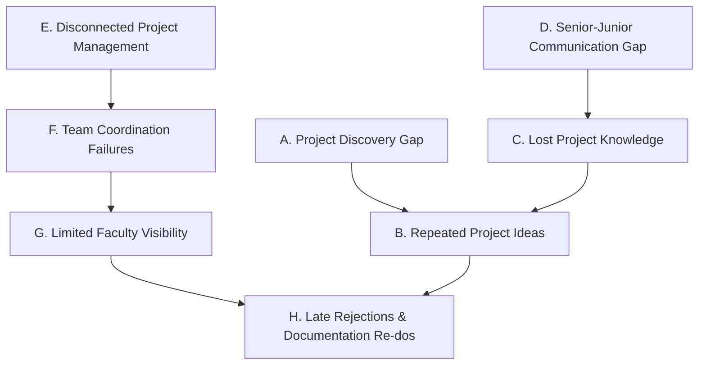

# 02 — Comprehensive Academic Problem Statement

In contemporary higher technical education, academic capstones and mini-projects constitute the primary vehicle for experiential engineering learning. However, the operational reality within engineering institutions suffers from severe structural deficiencies across discovery, collaboration, documentation, and evaluation.

---

## 1. The Eight Interconnected Core Problems

### A. Project Discovery Gap
Undergraduate students entering their 5th, 6th, or 7th semesters have no centralized digital repository to discover what previous student cohorts have built. Institutional knowledge remains confined to physical bound volumes in departmental libraries or unshared faculty spreadsheets. Students are forced to brainstorm in an information vacuum.

### B. Repeated Project Ideas & Unintentional Redundancy
Because historical projects are unindexed and unsearchable, student teams repeatedly submit essentially identical project ideas (e.g., basic Attendance Management, generic E-commerce stores, or rudimentary sentiment analyzers) year after year. This leads to severe academic stagnation and high rejection rates during synopsis review committees.

### C. Lost Project Knowledge & Dead-End Repositories
Upon graduation, the vast majority of student project artifacts—including architectural diagrams, database schemas, GitHub repositories, live demonstrations, and recorded implementation hurdles—are permanently lost. Incoming cohorts cannot build on prior achievements, resulting in a continuous cycle of rebuilding the same basic prototypes from ground zero.

### D. Senior-Junior Communication & Mentorship Gap
Junior students seeking technical advice or domain clarity on complex engineering tools (such as PyTorch, Docker, or WebSockets) have no secure institutional mechanism to connect with senior alumni who solved identical problems in previous semesters. Direct contact is hindered by privacy concerns, lack of contact directories, and graduation departures.

### E. Disconnected Project Management Tools
Student engineering teams manage their capstones through fragmented, consumer-grade tools: WhatsApp for ad-hoc chatting, Google Sheets for task tracking, Google Drive for document drafts, and Trello for boards. This fragmentation creates data silos, lost version history, and zero formal milestone tracking.

### F. Team Coordination & Free-Rider Dilemmas
Academic project teams (typically 2 to 4 students) struggle with unequal contribution tracking and vague task assignments. Without verifiable audit logs of milestone deliverables, team leaders bear disproportionate workloads while peer accountability collapses.

### G. Limited Faculty Visibility & Late-Stage Interventions
Faculty project guides typically supervise 5 to 10 distinct project batches simultaneously. Due to the lack of transparent, real-time dashboards, faculty only observe student work during high-stakes internal review presentations. Technical deviations, unviable architectures, and missed deadlines are discovered weeks too late, when rectifying them disrupts semester exam preparation.

### H. Academic Documentation & Formatting Difficulties
Engineering capstones require strict adherence to formal standards, such as IEEE 830 Software Requirements Specifications (SRS), department-specific front matter, font hierarchies, margin standards, and defense rubrics. Students waste dozens of engineering hours struggling with document formatting, leading to rejected synopses and non-compliant reports.

---

## 2. Why a Centralized Academic Ecosystem is Mandatory

These eight problems are **causally linked**:
- The **Discovery Gap (A)** directly causes **Repeated Ideas (B)** and is sustained by **Lost Knowledge (C)**.
- The **Senior-Junior Gap (D)** deprives juniors of the technical grounding needed to prevent **Coordination Failures (F)**.
- **Disconnected Tools (E)** hide progress from faculty, producing **Limited Faculty Visibility (G)**.
- Combined, these failures culminate in **Documentation Difficulties (H)** and late viva defense failures.

A unified academic platform like **CampusProjectHub** addresses all eight issues by housing historical benchmarks, team collaboration workspaces, AI-assisted feasibility audits, and automated IEEE 830 documentation within a single institutional lifecycle.

---

## 3. Implementation Status
- **Status:** `Implemented` (Addressed across Repository Search, AI Feature Evaluation, Proposal Generator, and Faculty Submission modules).
