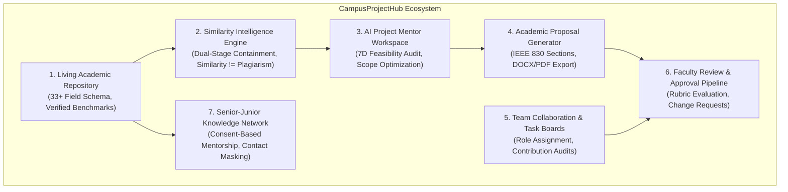

# 04 — The Proposed Solution: CampusProjectHub

## 1. Solution Architecture Overview

**CampusProjectHub** is an end-to-end digital ecosystem that unifies academic project administration, team collaboration, institutional knowledge preservation, and AI-driven pedagogical mentorship into a single platform.

---

## 2. The Seven Pillars of the CampusProjectHub Solution

### Pillar 1: Centralized Living Project Repository
- Replaces physical project book stacks with a searchable digital repository.
- Preserves complete project dossiers: abstracts, problem statements, architectures, technology stacks, GitHub links, live demonstrations, and execution hurdles.
- Categorizes projects by department, academic year, category, and verification status (`VERIFIED_HISTORICAL`, `FACULTY_APPROVED`, `PENDING_VERIFICATION`).

### Pillar 2: Dual-Stage Project Similarity Intelligence
- Implements an automated similarity engine based on token n-gram Jaccard containment and technology classification.
- **Academic Guardrail (Similarity != Plagiarism):** Strictly differentiates between projects that merely share technologies (e.g. React & Node.js) and projects with genuine conceptual duplication.
- Provides constructive pedagogical critiques: *"Your idea shares the core concept of a 2024 project. What new capability or algorithmic improvement do you plan to introduce?"*

### Pillar 3: Dedicated AI Project Mentor (`/ai-mentor`)
- A full-page, honest academic assistant—not a generic agreeable chatbot.
- Audits proposed features across **7 dimensions**: Problem Relevance, User Value, Originality, Technical Feasibility, Complexity, Resource Requirements, and Time Suitability.
- Classifies features into `ESSENTIAL`, `RECOMMENDED`, `OPTIONAL`, and `UNNECESSARY` to prevent semester scope-creep collapse.

### Pillar 4: Automated IEEE 830 Proposal Generation (`/ai-mentor/proposals/:id`)
- Synthesizes student decisions into a complete 15-section academic proposal.
- Offers in-place section-level AI refinement (clarity, grammar, technical rigor, shorten, expand) without overwriting manual student edits.
- Generates real OpenXML `.docx` and buffer-validated `.pdf` documents with institutional front matter, page numbers, and proper margins.

### Pillar 5: Structured Student Team Collaboration
- Provides dedicated capstone workspaces with student role definitions, responsibility tracking, and stage-gated milestone boards.
- Solves the free-rider dilemma by recording milestone contribution histories.

### Pillar 6: Transparent Faculty Review & Approval Pipeline
- Multi-state workflow transitions (`DRAFT` ➔ `SUBMITTED` ➔ `CHANGES_REQUESTED` ➔ `APPROVED`).
- Allows faculty guides to log line-item change requests, evaluate project rubrics, and track resubmissions across semesters.

### Pillar 7: Consent-Based Senior-Junior Knowledge Transfer
- Connects current students with past project authors.
- **Privacy First:** Student contact details (email, phone numbers) are masked by default. Mentorship interactions occur through in-platform requests, safeguarding student privacy.

---

## 3. Measurable Value Delivered

| Dimension | Existing System | CampusProjectHub |
| :--- | :--- | :--- |
| **Topic Redundancy** | High (Unintentional duplicates) | Near-zero (Instant similarity alerts) |
| **Scope Feasibility** | Often unfeasible (Scope creep) | Verified (7-dimensional feasibility audit) |
| **Documentation Effort** | Days of manual formatting | Instant IEEE 830 generation with DOCX/PDF export |
| **Faculty Visibility** | Opaque until final presentation | Real-time milestone and submission audit trails |
| **Knowledge Preservation** | Lost upon graduation | Permanently preserved with source code and architecture |

---

## 4. Current Implementation Status
- **Status:** `Implemented` across core frontend routes (`/`, `/explore-projects`, `/ai-mentor`, `/ai-mentor/proposals/:id`) and Express backend modules (`repository`, `ai`, `feature-evaluation`, `proposals`).
