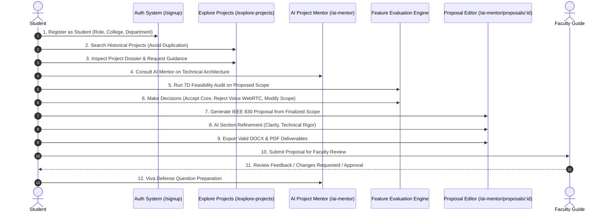

# 07 — Complete Student Lifecycle Workflow

The student journey in CampusProjectHub spans ideation, exploration, team collaboration, technical evaluation, proposal defense, and final archival.

---

## Detailed Step-by-Step Breakdown

### Step 1: Academic Registration & Authentication
- Navigates to `/signup` (Redesigned in Task 13A).
- Selects the **Student (Capstone Innovator)** role card.
- Enters Full Name, College Email (`.edu` / institutional domain), College Name, and Engineering Department.
- Authenticates securely via JWT and session tokens.

### Step 2: Historical Benchmark Discovery
- Visits `/explore-projects` to survey departmental prior art.
- Applies multi-filters: Department (e.g. CSE), Technology (e.g. React, PyTorch), Academic Year (e.g. 2024–2025).
- Identifies benchmark projects to ensure their proposed idea is genuinely novel.

### Step 3: Deep Project Inspection & Senior Mentorship
- Opens project detail page (`/explore-projects/:id`).
- Studies architecture diagrams, GitHub repositories, and recorded implementation challenges.
- Submits an in-platform mentorship request to past batch authors without exposing private email or phone numbers.

### Step 4: AI Project Mentor Ideation Consultation
- Enters `/ai-mentor` workspace.
- Chats with the AI Project Mentor regarding algorithms, data structures, and tech stacks.
- The AI Mentor injects repository intelligence, highlighting potential overlap and asking critical examiner defense questions.

### Step 5: 7-Dimensional Feature Feasibility Audit
- Clicks **Feature Evaluation** in `/ai-mentor`.
- Enters team constraints: Team Size (e.g. 3), Experience (e.g. Intermediate), Duration (e.g. 12 weeks), Tech Stack.
- The engine audits proposed features across 7 dimensions and computes holistic feasibility.

### Step 6: Student Decision Authority (Accept / Reject / Modify)
- Reviews feature cards with classification badges (`ESSENTIAL`, `RECOMMENDED`, `OPTIONAL`, `UNNECESSARY`).
- Accepts core capabilities.
- **Explicitly Rejects Unnecessary Features:** Rejects high-risk features (such as Real-Time Voice WebRTC), generating an automated defense trade-off rationale.
- Modifies complex features to fit the 12-week timeline.
- Generates the **Final Project Scope** with 3-phase milestones.

### Step 7: Automated Proposal Generation
- Clicks **Generate Academic Proposal (IEEE 830)** in the Final Scope modal.
- System automatically generates a 15-section proposal and redirects to `/ai-mentor/proposals/:proposalId`.

### Step 8: Section-Level Refinement & Autosave
- Navigates through 15 sections in the dedicated 3-panel workspace.
- Edits sections directly in the canvas.
- Uses AI Quick Actions (`Clarity`, `Grammar`, `Technical Rigor`, `Shorten`, `Expand`).
- Inspects proposed revisions via the in-place diff preview before accepting.
- All manual edits are flagged and protected from overwrite.

### Step 9: Advisory Readiness & Quality Check
- Inspects the **Readiness Tab** auditing 9 transparent criteria (Problem clarity, Objective alignment, Scope consistency, etc.).
- Verifies overall rating: `Ready for Faculty Review`.

### Step 10: Exporting Binary Documents
- Clicks **DOCX** or **PDF** in the header.
- System downloads a fully formatted binary OpenXML `.docx` or PDFKit `.pdf` file with cover sheet, page numbers, and standard IEEE references.

### Step 11: Submission to Faculty & Viva Defense
- Clicks **Submit Proposal**, enters guide name and comments.
- Status updates to `SUBMITTED`.
- Returns to `/ai-mentor` to practice viva defense questions generated by the AI Mentor based on the proposal.
