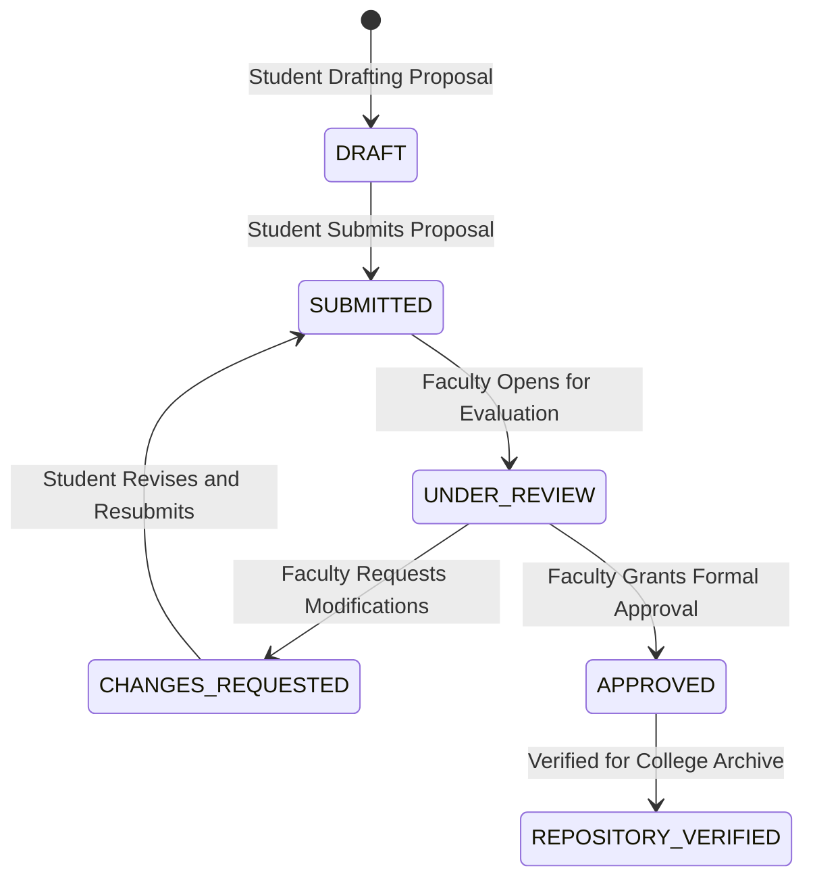

# 08 — Complete Faculty Workflow & Governance

Faculty supervision is the formal gatekeeper of academic integrity. CampusProjectHub maintains a strict distinction: **AI provides pedagogical advice; only human faculty members hold academic approval authority.**

---

## 1. Faculty Roles & Permissions

- **Assigned Project Guide:** Direct technical mentor for an assigned cohort of 3–5 teams. Reviews weekly milestone updates, inspects git commits, and reviews draft documentation.
- **Department Review Panel Member:** Senior faculty evaluator reviewing synopsis defense, mid-semester progress, and final capstone vivas.
- **Project Coordinator / HoD:** Administrative authority managing guide assignments, approving final project grades, and verifying completed projects for public repository indexing.

---

## 2. Step-by-Step Faculty Lifecycle

### Step 1: Faculty Account Registration
- Navigates to `/signup`.
- Selects the **Faculty (Academic Mentor & Evaluator)** role card.
- Specifies Official Institutional Email, College Name, Department, and Faculty ID.
- Granted faculty authorization token (`role: 'faculty'`).

### Step 2: Accessing the Department Submissions Queue
- Faculty dashboard displays incoming student proposals flagged by submission status:
  - `SUBMITTED`: Awaiting initial guide review.
  - `CHANGES_REQUESTED`: Revision pending from student team.
  - `APPROVED`: Formally signed off for the semester milestone.

### Step 3: Proposal Review & AI Advisory Cross-Reference
- Faculty inspects the submitted proposal via the Proposal Viewer.
- Views the student's 15 sections alongside the **AI Advisory Readiness Audit**:
  - The AI readiness rating serves as a rapid advisory checklist (pointing out missing sections, short abstracts, or scope inconsistencies).
  - Faculty can override or add specific academic directives.

### Step 4: Line-Item Critique & Changes Requested
- If the proposal requires adjustments (e.g., adding hardware constraints or refining methodology):
  - Faculty inputs specific critique notes: *"Clarify the difference between your proposed caching layer and the 2024 repository benchmark."*
  - Sets status to `CHANGES_REQUESTED`.
  - The student team is notified with timestamped feedback, preserving the revision chain.

### Step 5: Milestone Tracking & Code Verification
- During the 12-week development phase, faculty track progress against the 3 milestone phases:
  - Phase 1: Foundation & Data Architecture (~Week 4)
  - Phase 2: Intelligence Engine & Core Workflows (~Week 9)
  - Phase 3: Testing, Proposal Documentation & Defense (~Week 12)
- Inspects GitHub pull requests, architecture diagrams, and working software builds.

### Step 6: Final Milestone Sign-Off & Repository Verification
- Upon successful viva defense:
  - Faculty guide grants `APPROVED` status.
  - Project Coordinator verifies the project record (`verificationStatus: 'FACULTY_APPROVED'`).
  - Project artifacts (report, code link, screenshots, architecture) are indexed into the **College Academic Repository** for future cohorts to study.

---

## 3. Strict Institutional Governance Rule
> [!IMPORTANT]
> **AI Cannot Approve Proposals:** The AI Project Mentor's readiness assessment is purely advisory (`READY_FOR_FACULTY_REVIEW`). The platform prevents automated AI approvals. Only authenticated faculty guides (`X-Student-Id: 'faculty-reviewer'` or session role `faculty`) can transition a proposal or project to `APPROVED`.
