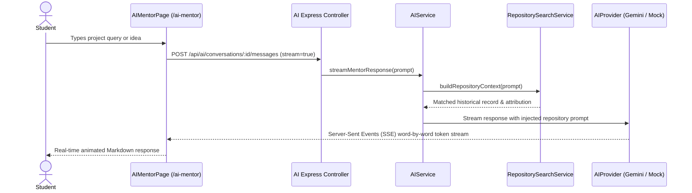

# 11 — The Dedicated AI Project Mentor Workspace

The **AI Project Mentor — Your Honest Academic Project Guide** is a dedicated full-page workspace accessible at `/ai-mentor`. It is engineered as an objective, pedagogically rigorous academic advisor.

---

## 1. System Persona & Behavioral Philosophy

Unlike commercial chatbots designed to be maximally agreeable and sycophantic, the AI Project Mentor enforces strict academic principles:

```text
Student: "We want to build a platform that does Blockchain, AI, IoT, and Mobile in 8 weeks!"
Commercial Chatbot: "Sounds amazing! Here is a plan to build all four!"
AI Project Mentor: "Scope Warning: Attempting all four in 8 weeks is a known failure trap. 
                     Examiners will penalize an unfinished prototype. 
                     Focus 70% of effort on your core algorithmic layer."
```

### Core Behavioral Guidelines
1. **Direct, Educational, and Constructive:** Challenge flawed assumptions and unfeasible scope claims honestly.
2. **One Question at a Time:** In conversational ideation, ask only one relevant, clarifying question per turn to avoid overwhelming the student.
3. **Repository Grounding:** When students propose ideas, query the college repository and cite real historical benchmarks.
4. **Zero Fabrication Policy:** Never fabricate citations, benchmark numbers, research papers, or claimed integrations. If referencing standards, use real entities (IEEE 830, RFC 7519, OWASP).
5. **Multilingual Inclusivity:** Supports native queries and technical responses in **English**, **Kannada (ಕನ್ನಡ)**, and **Hindi (हिन्दी)**.

---

## 2. Technical Architecture & Communication Flow



---

## 3. Streaming Server-Sent Events (SSE)
- Protocol: HTTP SSE (`Content-Type: text/event-stream`, `Connection: keep-alive`).
- Event types emitted:
  - `start`: Acknowledgement of generation request.
  - `token`: Individual word/token chunk streamed in real-time.
  - `done`: Final completed message payload with token counts.
  - `error`: Structured error code and message.
- Client-Side: Supports instant interruption via `AbortController` (`onStopGeneration`).

---

## 4. Multilingual Capabilities
- **Kannada (ಕನ್ನಡ):** Handles queries written in Kannada script or Manglish. Provides culturally sensitive, grammatically accurate academic advice in Kannada.
- **Hindi (हिन्दी):** Processes Devanagari script and Hinglish, guiding students on project scope, database normalization, and viva preparation.
- **English:** Primary language for technical IEEE specifications and architectural diagrams.

---

## 5. Simulated Voice Mode Preview
- Accessible via the **Voice Mode** header button.
- Provides a simulated interactive audio waveform visualizer and speech synthesis interface, preparing students for future voice-based viva defense drills.
