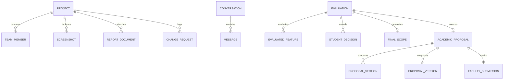

# 15 — Database Architecture & Data Models

CampusProjectHub employs a document-oriented database architecture built on MongoDB and Mongoose ODM, accompanied by concurrent in-memory fallback stores.

---

## 1. Schema Specifications & Indexes

### Collection 1: `projects` (`ProjectSchema`)
- **Primary Indexes:**
  - `title`: Text and compound index for rapid fuzzy lookup.
  - `slug`: Unique index for clean URL routing (`/explore-projects/:slug`).
  - `department` & `academicYear`: Compound index for catalog filtering.
  - `verificationStatus` & `reviewStatus`: Administrative filtering.
- **Key Fields:** 33+ canonical fields including `abstract`, `problemStatement`, `objectives`, `features`, `technologyStack`, `learningOutcomes`, `futureEnhancements`, `teamMembers`, `facultyGuide`, `reportDocuments`, and `githubUrl`.

### Collection 2: `conversations` (`ConversationSchema`) & `messages` (`MessageSchema`)
- **Indexes:** `ownerId` (Student ID) and `updatedAt`.
- **Relationship:** 1-to-Many between conversation and messages.
- **Fields:** `title`, `ownerId`, `role` (`user` | `assistant` | `system`), `content`, `status` (`streaming` | `completed` | `error`), `metadata` (`tokensUsed`, `model`, `provider`).

### Collection 3: `feature_evaluations` (`EvaluationSchema`)
- **Indexes:** `ownerId`, `conversationId`, `projectTitle`.
- **Fields:**
  - `constraints`: `teamSize`, `technicalExperience`, `developmentWeeks`, `semesterDeadline`, `languagesAndFrameworks`, `hardwareResources`, `budget`.
  - `overallFeasibility`: `rating` (`FEASIBLE_INITIAL`, `FEASIBLE_REDUCED_SCOPE`, `REQUIRES_RESOURCES_OR_TIME`, `NOT_FEASIBLE`), `summary`, `primaryBottlenecks`.
  - `features`: Array of 7-dimensional evaluated features with classification (`ESSENTIAL`, `RECOMMENDED`, `OPTIONAL`, `UNNECESSARY`).
  - `decisions`: Student decision audit trail (`ACCEPTED`, `REJECTED`, `MODIFIED`, `tradeoffNotes`).
  - `finalScope`: Synthesized scope with 3-phase milestones, risks, and assumptions.

### Collection 4: `academic_proposals` (`ProposalSchema`)
- **Indexes:** `studentId`, `projectTitle`, `sourceEvaluationId`.
- **Fields:**
  - `documentType`: `MINI_PROJECT_PROPOSAL` | `PROJECT_SYNOPSIS`.
  - `template`: Institutional metadata (VTU CSE standard).
  - `sections`: Array of 15 sections with word counts, manual edit flags, and timestamps.
  - `versions`: Immutable snapshot chain (`versionNumber`, `sections`, `revisionSummary`, `createdAt`).
  - `readiness`: 9-criterion audit record (`overallRating`, `suggestions`).
  - `submission`: Faculty review status (`DRAFT`, `SUBMITTED`, `CHANGES_REQUESTED`, `APPROVED`), `facultyGuideName`, `comments`.

### Collection 5: `audit_logs` (`AuditLogSchema`)
- **Indexes:** `action`, `performedBy`, `timestamp`.
- **Fields:** Administrative imports, verification status changes, and duplicate title warnings.

---

## 2. In-Memory Resilient Fallback Stores

To satisfy zero-downtime requirements and ensure reliable execution in isolated test harnesses, every model pairs with a native TypeScript Map store:
- `InMemoryProjectStore`
- `InMemoryConversationStore`
- `InMemoryEvaluationStore`
- `InMemoryProposalStore`

The repositories (`projectRepository`, `conversationRepository`, `evaluationRepository`, `proposalRepository`) inspect `mongoose.connection.readyState === 1`. If connected, operations execute against MongoDB Atlas; otherwise, requests fall back smoothly to memory without throwing database connection exceptions.
