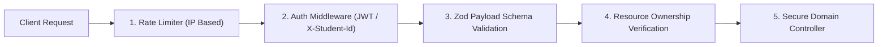

# 17 — Security, Data Protection & Student Privacy

Academic platforms handle sensitive student credentials, proprietary capstone source code, and confidential faculty evaluations. CampusProjectHub implements multi-layered security controls.

---

## 1. Authentication & Role-Based Access Control (RBAC)

### Roles Defined
- **`student`**: Can create and edit own conversations, evaluations, team workspaces, and proposals. Cannot view unmasked peer contact info or approve proposals.
- **`faculty`**: Can review assigned student proposals, log change requests, grade rubrics, and access unmasked contact info for direct academic supervision.
- **`admin`**: Department project coordinator or HoD with rights to bulk-import historical archives and verify completed projects for the public repository.

---

## 2. Resource Ownership Protection (403 Forbidden Enforcement)

Every persistent entity (`conversation`, `evaluation`, `proposal`) binds to the authenticated creator (`ownerId` / `studentId`):
- When a student attempts to query or mutate an entity owned by another student:
  - The controller compares `resource.ownerId !== requestingStudentId`.
  - The request is immediately rejected with HTTP `403 Forbidden`.
  - Audited and verified across automated test suites (`ai.test.ts`, `evaluation.test.ts`, `proposal.test.ts`).

---

## 3. Student Privacy & Contact Information Masking

Under institutional privacy standards, student phone numbers and email addresses are treated as **Protected Personal Identifiable Information (PII)**:
- In all public repository discovery and search endpoints (`GET /api/repository/search`, `GET /api/repository/projects/:id`):
  - `email` is transformed to `"***@college.edu"`.
  - `phone` is transformed to `"***-***-****"`.
- Junior students cannot harvest alumni contact details for mass solicitation.
- Communications must route through the **In-Platform Consent Gateway**, where senior authors explicitly choose whether to engage.

---

## 4. Internal Faculty Review Note Shielding

When a faculty panel rejects or requests changes on a student submission:
- Internal review comments (`changeRequests.notes`, `rejectionReason`) are strictly confidential.
- The repository search controller strips internal critique notes from public responses.
- Only authenticated faculty guides and the specific owning team members can view review critiques.

---

## 5. Input Validation & Injection Defense

- All incoming request bodies, route parameters, and query strings pass through strict **Zod schemas**.
- Unexpected fields, illegal status strings, or oversized message payloads (>4000 characters) are rejected before reaching database drivers, neutralizing NoSQL injection risks.
- Rate limiting throttles excessive requests to prevent denial-of-service on AI generation endpoints.
